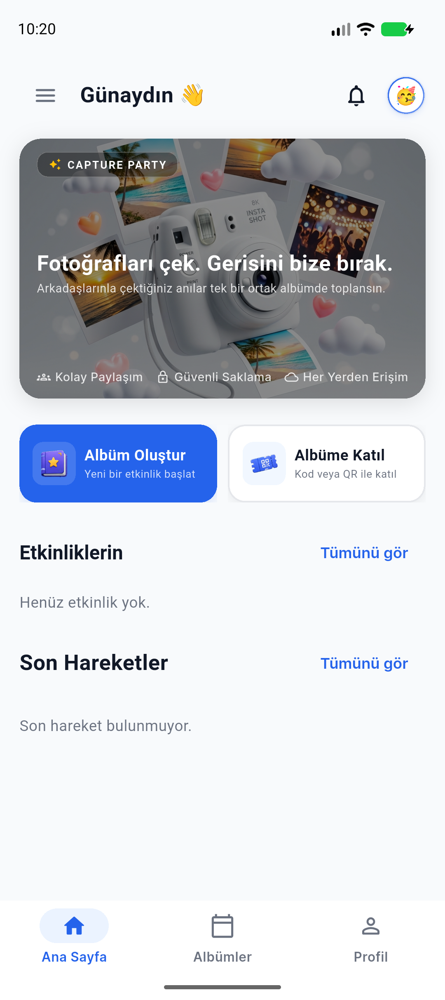
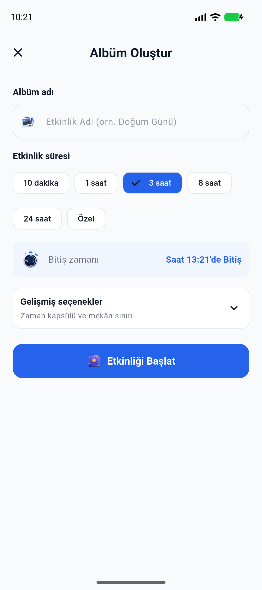

# Capture Party

**Take photos. We'll handle the rest.**

A shared event album app that brings everyone's memories together. Create an event, invite people with a code or QR, and collect photos in one place while everyone enjoys the moment.

  
  
  

*Screens captured from the latest local v2.0.3 development build, dated August 10, 2026.*

## The experience

- **One event, one shared album.** Bring photos from different participants together.
- **Easy invitations.** Join an album using an event code or QR.
- **Choose how to share.** Use automatic sync with gallery access, or explicitly select the photos you want to share.
- **Keep using your camera.** Take photos with the phone's normal camera app.
- **Clear progress.** See when photos are queued, uploading, shared, or need another attempt.

Automatic background uploads depend on the device's operating system, permissions, and network conditions.

## Project

Built with **Flutter and Dart**. Developed by **[Eralp Yayalık](https://github.com/Eralpyayalik)**.

Capture Party is under development. This is a public product showcase; application source code, backend configuration, credentials, and installable builds are not distributed here.

## Türkçe

Capture Party, aynı etkinlikte çekilen fotoğrafları ortak bir albümde buluşturan bir mobil uygulamadır. Bir etkinlik oluşturun, kod veya QR ile katılın ve paylaşım tercihinize göre anılarınızı biriktirin.

Bu depo yalnızca uygulamanın tanıtımını ve son yerel sürümden alınan ekran görüntülerini içerir. Kaynak kodu ve APK paylaşılmaz.
